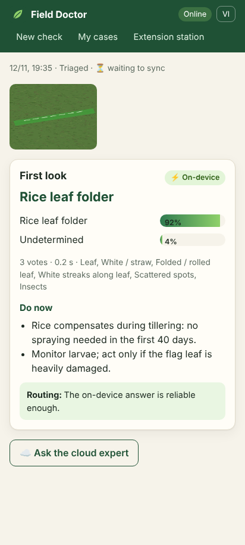
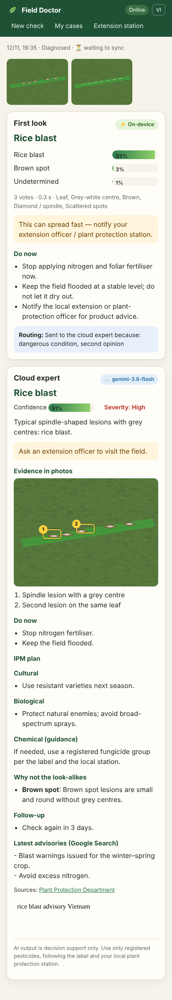
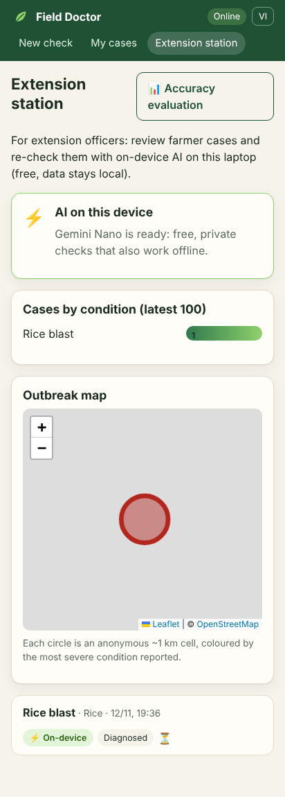
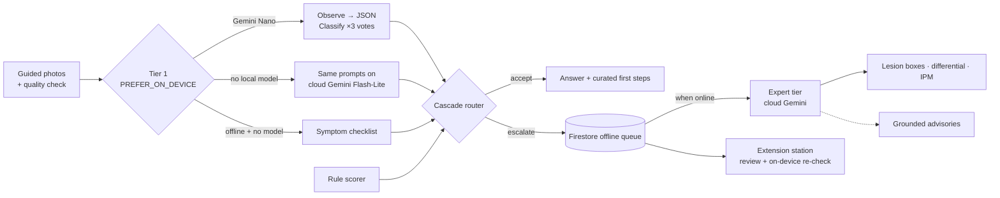

# Field Doctor · Bác sĩ Đồng ruộng

**Hybrid on-device + cloud crop health assistant for Mekong Delta farmers and extension officers, built with Firebase AI Logic.**

A farmer photographs a sick rice plant. Field Doctor checks the photo, describes the symptoms and gives safe first steps in seconds: on Gemini Nano when the device has it (free, private, works with no signal), or on cloud Gemini through the same SDK call when it doesn't. A cascade router decides whether that first answer is good enough. Dangerous or uncertain cases go to a larger cloud "expert" model that locates lesions on the photo and writes an IPM plan. If the farmer is offline, the case waits in a queue and completes when signal returns.

> Built for [#BuildHybridAI 2026](https://firebasehybridaihackathon.devpost.com/). Platform: **Web (Chrome)**, installable PWA.

| Field result on device | Cloud expert with located lesions | Extension station |
|---|---|---|
|  |  |  |

<sub>Screenshots from the automated test run with synthetic photos.</sub>

## Features

- **Guided capture** with instant, offline blur and exposure checks.
- **On-device first look**: Gemini Nano describes symptoms and votes three times on a closed list. Curated first steps are shown at once.
- **Cascade router** with explainable escalation reasons, tunable in Remote Config.
- **Cloud expert**: differential diagnosis, lesion boxes on the photos, an IPM plan, and grounded current advisories.
- **Works offline**: an installable PWA with an on-device or checklist answer. The expert step is queued and runs automatically when signal returns.
- **Extension station**: an anonymous outbreak map, a free on-device re-check on the officer's laptop, and officer verdicts sent back to farmers.
- **Evaluation page**: hybrid cascade vs on-device only vs cloud only on labelled photos, with CSV export.
- **Two crop modules** (rice, durian) and a Vietnamese / English UI.

## Why hybrid, concretely

Most farmers' phones cannot run an on-device model, while many extension officers have laptops that can. Field Doctor is designed around that reality instead of assuming every device is a flagship.

| Task | Where it runs | Why |
|---|---|---|
| Photo quality check (blur, darkness) | Plain JavaScript on the device | Instant and offline; a bad photo is the main cause of a wrong answer |
| Symptom description → constrained JSON | **On-device** (Gemini Nano), cloud fallback | Free and private on capable devices; same code everywhere via `PREFER_ON_DEVICE` |
| Classification against the crop's closed list, ×3 self-consistency votes | **On-device** | Extra votes cost nothing locally and measure the model's own reliability; in the cloud one vote is enough |
| Rule-based cross-check of the symptoms | Plain JavaScript | Deterministic and explainable; disagreement triggers escalation |
| Expert diagnosis: differential, lesion boxes, IPM plan | **Cloud** (larger Gemini) | Needs full-size photos and more reasoning than a small model has |
| Current advisories | **Cloud** + Grounding with Google Search | Outbreak warnings change weekly |
| Offline with no on-device model | Symptom checklist → same rules and router | The app still gives an answer and queues the expert step |
| Extension officer re-check | **On-device only** (`ONLY_ON_DEVICE`) | Free triage of many farmer cases on the officer's laptop; data stays local |

## Architecture



The router escalates when any of these hold, with thresholds in **Remote Config** so they can be tuned per season without a release:

- photo quality is poor;
- the answer is `unknown`;
- combined confidence (confidence × agreement between votes) is below the threshold;
- the top two candidates are too close;
- the model contradicts the symptom rules;
- the condition is high-severity and fast-spreading (always get a second opinion);
- the farmer asks for it.

## How Firebase AI Logic is used

- `getGenerativeModel(ai, { mode: InferenceMode.PREFER_ON_DEVICE, onDeviceParams, inCloudParams })` for tier 1 ([`src/ai/tier1.ts`](src/ai/tier1.ts)), with `ONLY_ON_DEVICE` for the station re-check.
- One JSON Schema is passed as `responseConstraint` on device and `responseJsonSchema` in the cloud ([`src/ai/schemas.ts`](src/ai/schemas.ts)), so the app parses one shape wherever inference ran.
- `response.inferenceSource` drives the ⚡ on-device / ☁️ cloud badge and the number of self-consistency votes.
- `initializeDeviceModel()` starts the Gemini Nano download from a user click ([`src/app/AppState.tsx`](src/app/AppState.tsx)).
- Multimodal expert tier with located evidence, plus Grounding with Google Search showing the required search suggestions ([`src/ai/expert.ts`](src/ai/expert.ts)).
- Also used: **App Check** (reCAPTCHA Enterprise), **Anonymous Auth**, **Firestore** with persistent offline cache, **Cloud Storage**, **Remote Config**, **Hosting**.

## Crop knowledge

Crops are modules ([`src/knowledge/crops`](src/knowledge/crops)): capture guide, growth stages, conditions with symptom profiles, severity and curated non-chemical first steps in Vietnamese and English. Two crops ship today:

- **Rice:** blast, bacterial leaf blight, sheath blight, brown spot, brown planthopper, leaf folder, grassy/ragged stunt, golden apple snail.
- **Durian:** Phytophthora root rot and stem canker, anthracnose, leaf blight, pink disease, psyllid, fruit borer, mealybugs, algal leaf spot.

Adding a crop (or later livestock or shrimp) means adding one module.

Safety: first steps shown immediately are curated, never model-generated. The expert tier is instructed never to give pesticide doses or brands, only active-ingredient groups registered in Vietnam, with a pointer to the local plant protection station.

## Run it

Requirements: Node 20+, a Firebase project, and Chrome desktop 148+ for on-device inference (16 GB RAM / 4 cores, or a GPU with more than 4 GB VRAM).

1. In the Firebase console:
   - enable **AI Logic** with the Gemini Developer API;
   - enable **Anonymous** sign-in, **Firestore**, **Storage** and **Remote Config**;
   - register a Web app;
   - in **App Check**, register reCAPTCHA Enterprise for the Web app.
2. Configure and start:
   ```bash
   cp .env.example .env.local   # fill in your Web app config and site key
   npm install
   npm run dev
   ```
3. On first load the console prints an App Check debug token. Register it under **App Check → Manage debug tokens**.
4. Deploy rules and hosting:
   ```bash
   firebase deploy --only firestore,storage,hosting
   ```
5. To use the extension station, create an empty document `stations/{uid}` in Firestore. The station page shows your UID.

Check on-device availability in DevTools: `await LanguageModel.availability()`.

Remote Config keys (all optional; defaults in [`src/lib/settings.ts`](src/lib/settings.ts)):
`tier1_runs`, `tier1_max_images`, `escalate_confidence_below`, `escalate_margin_below`, `escalate_high_severity`, `triage_cloud_model`, `expert_cloud_model`, `enable_grounding`.

## Test

```bash
npm test            # 27 unit tests: router, rule scorer, photo quality, parsing, outbreak map, evaluation
npm run test:e2e    # 15 end-to-end tests in Chrome (Auth emulator, simulated Gemini Nano, intercepted cloud Gemini)
npm run emulators   # Auth, Firestore and Storage emulators; then VITE_USE_EMULATORS=true npm run dev
npm run lint && npm run build
```

What is real and what is simulated in the tests, the bugs they caught, and the manual pass to run before submitting: [docs/TESTING.md](docs/TESTING.md). Submission material: [docs/SUBMISSION.md](docs/SUBMISSION.md), [docs/VIDEO_SCRIPT.md](docs/VIDEO_SCRIPT.md), [docs/CHECKLIST.md](docs/CHECKLIST.md).

## Project layout

```
src/
  ai/          tier 1 (hybrid), expert tier, router, schemas, prompts
  capture/     photo normalisation and quality checks
  cases/       Firestore cases, IndexedDB photo store, offline cloud queue, outbreak cells
  eval/        evaluation runner and metrics
  knowledge/   crop modules (rice, durian), symptom vocabulary, rule scorer
  pages/ ui/   farmer, extension-station and evaluation screens
  i18n/        Vietnamese / English
e2e/           Playwright scenarios, simulated Prompt API and cloud endpoint
docs/          testing, submission text, video script, checklist, screenshots
```

## License

[MIT](LICENSE) © AGRHUB
